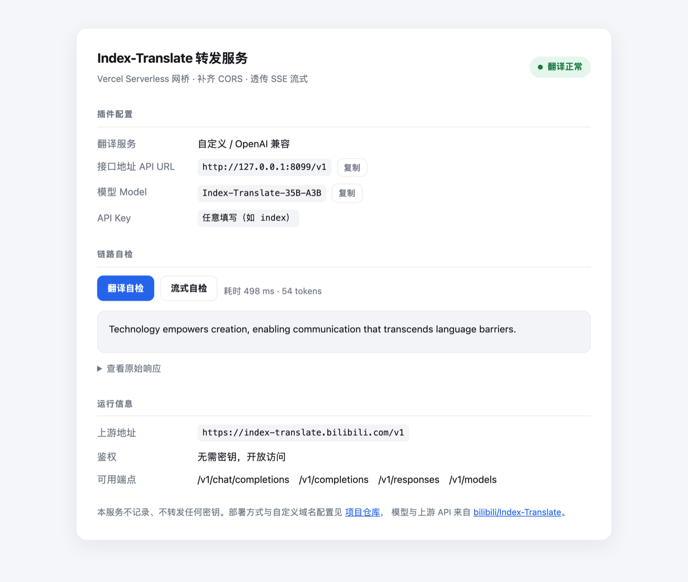

# index-translate-proxy

把 [Index-Translate](https://github.com/bilibili/Index-Translate) 的**免费公共 API** 转成浏览器插件
可以直接调用的 **OpenAI 兼容端点**。Vercel Serverless，零依赖，透传 SSE 流式响应。

[](https://github.com/tortrixx/index-translate-proxy/actions/workflows/test.yml)


[快速开始](#快速开始) • [插件配置](#插件配置) • [API](#api) • [工作原理](#工作原理) • [环境变量](#环境变量) • [限制](#限制) • [开发](#开发)



## 快速开始

**一键部署**（不需要本地环境）：

[](https://vercel.com/new/clone?repository-url=https://github.com/tortrixx/index-translate-proxy)

点击后登录并授权 Vercel，它会自动在你的账号下建一份仓库副本并完成部署。之后改动副本代码，Vercel 会自动重新部署。

**或者用命令行**：

```bash
git clone https://github.com/tortrixx/index-translate-proxy
cd index-translate-proxy
npx vercel deploy --prod
```

部署完会得到 `https://<项目名>.vercel.app`，直接可用：

```bash
curl https://<项目名>.vercel.app/v1/chat/completions \
  -H 'Content-Type: application/json' \
  -d '{"model":"Index-Translate-35B-A3B","messages":[{"role":"user","content":"请将以下文本翻译为英语，直接输出翻译结果。\n\n今天天气真好。"}]}'
```

> **中国大陆用户**：`*.vercel.app` 直连会被 TLS reset，建议绑定自有域名 —— 见
> [DEPLOY.md](DEPLOY.md#3-绑定自定义域名中国大陆必需)。

## 插件配置

以「沉浸式翻译」的自定义 OpenAI 兼容服务为例，Index-Translate 官方扩展同理：

| 配置项 | 值 |
| --- | --- |
| 翻译服务 | 自定义 / OpenAI 兼容 |
| 接口地址 API URL | `https://<你的域名>/v1` |
| 模型 Model | `Index-Translate-35B-A3B` |
| API Key | 未设 `PROXY_API_KEY` 时随便填（如 `index`） |

部署后浏览器打开 `https://<你的域名>/`，页面上可一键跑通「翻译自检 / 流式自检」。

## API

接口与 OpenAI 兼容，插件只需要 `chat/completions`：

| 端点 | 说明 |
| --- | --- |
| `POST /v1/chat/completions` | 插件主入口 |
| `POST /v1/responses` | OpenAI Responses API |
| `POST /v1/completions` | 老式补全（上游未实现，原样透传其错误） |
| `GET /v1/models` | 模型列表（上游不可用时回退内置表） |
| `GET /v1` | 服务状态与配置自检（JSON） |

支持 `stream: true` 的 SSE 流式响应；只放行上述路径，其余返回 404。

## 工作原理

上游免费 API 有两个问题，导致插件无法直连：

- **不返回任何 CORS 头** → 浏览器读不到响应体
- **对扩展来源直接 412** → 带 `Origin: chrome-extension://…` 的请求被 WAF 拦截

本服务在中间补上 CORS 头（含 4xx/5xx 响应），并且**不向上游转发 `Origin`**，从而绕开这两点。
其余行为与官方 `python call_api.py --serve` 对齐：默认注入 `enable_thinking=false`、`temperature=0`
（显式传值时不覆盖），逐块透传 SSE 不做缓冲。

## 环境变量

全部可选，在 Vercel 项目 **Settings → Environment Variables** 配置，改完需 Redeploy：

| 变量 | 默认 | 说明 |
| --- | --- | --- |
| `PROXY_API_KEY` | 不设置 | 不设 = 完全开放。设置后必须带 `Authorization: Bearer <key>`，也支持 `?key=` |
| `UPSTREAM_BASE` | 官方免费 API | 可改成自建的 vLLM / SGLang 端点，本服务即成为它的跨域网关 |
| `CONNECT_TIMEOUT_MS` | `30000` | 建连超时，超时返回 504 |
| `IDLE_TIMEOUT_MS` | `55000` | 流式空闲超时 |

## 限制

- **请求体上限约 4.5 MB**（Vercel 平台限制），图片翻译的超大 base64 会被 413，需压缩图片
- **单次函数最长 60s**（Hobby 上限，`vercel.json` 已设 `maxDuration: 60`；Pro 可提到 300）
- **`*.vercel.app` 在中国大陆直连会被 TLS reset**（SNI 封锁，与 IP 无关），绑定自有域名即可解决
- 上游是公益免费额度，请勿高频轰炸；如需防白嫖可加 `PROXY_API_KEY`

## 开发

```bash
node test/local-server.mjs                          # 本地 mock Vercel 环境 + 状态页：http://127.0.0.1:8080
node test/run-tests.mjs                             # 17 个用例：CORS / 流式 / 鉴权 / body 改写 / 上游隔离
npm run test:offline                                # 只跑离线用例（不访问外网，CI 跑的就是它）
PROXY_URL=https://<域名> node test/live-check.mjs    # 对已部署实例跑 8 项真实请求验收
./scripts/verify-domain.sh <域名>                    # DNS / 证书 / 直连 / 完整验收一把过
```

`test/run-tests.mjs` 会 spawn 子进程，复刻 Vercel 的 `rewrites` 与「JSON body 预解析到 `req.body`」
两个行为，因此本地通过的用例在线上同样成立。

## 相关

- **[DEPLOY.md](DEPLOY.md)** — 三种部署方式、自定义域名、故障排查表
- [bilibili/Index-Translate](https://github.com/bilibili/Index-Translate) — 上游项目、模型与官方本地代理

## License

MIT
